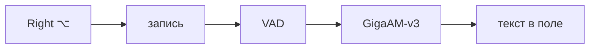

# Transcribator

Push-to-talk диктовка для macOS на базе открытой модели **GigaAM-v3** (SberDevices, MIT).
Зажимаешь клавишу — говоришь — отпускаешь: текст с пунктуацией вставляется в активное приложение.

Всё считается **локально**, без интернета и облаков.

```
⌥ (Right Option)  →  🎙 запись  →  GigaAM-v3 e2e  →  «Привет, как дела?» → Cmd+V в активное окно
```

## Как это работает



Подробные диаграммы — компоненты, последовательности записи и распознавания, протокол,
состояния иконки, смена модели, тайминги — в [docs/architecture.md](docs/architecture.md).

## Что внутри

| Компонент | Роль |
| --- | --- |
| `macapp/` | Swift-приложение: иконка в меню-баре, глобальная клавиша, запись с микрофона, вставка текста |
| `backend/worker.py` | Python-сайдкар: держит GigaAM в памяти, общается с приложением построчным JSON через pipe |
| `backend/cli.py` | Проверка распознавания по файлу, без GUI |
| `docs/architecture.md` | Диаграммы: как всё работает |
| `scripts/` | Установка зависимостей и сборка `.app` |

Модель: `v3_e2e_rnnt` по умолчанию — end-to-end версия, сразу выдаёт текст с пунктуацией,
заглавными буквами, числами и нормализацией («1 234 ₽» вместо «тысяча двести тридцать четыре рубля»).
По статье и бенчмаркам GigaAM-v3 обгоняет Whisper-large-v3 на русском примерно 70:30 в side-by-side.

## Требования

- macOS 13+ (проверено на macOS 26 / Apple Silicon M1 Pro)
- Python 3.10+ и [`uv`](https://docs.astral.sh/uv/) (`brew install uv`)
- `ffmpeg` (`brew install ffmpeg`) — нужен только для CLI-режима и для `gigaam`
- ~1.5 ГБ на venv с torch + ~450 МБ на веса модели (`~/.cache/gigaam`)

## Установка

```bash
make setup     # .venv + gigaam + torch, скачивает веса модели
make build     # собирает build/Transcribator.app (подпись — Apple Development / ad-hoc)
open build/Transcribator.app
```

Или по шагам:

```bash
./scripts/setup_backend.sh
./scripts/build_app.sh
open build/Transcribator.app
```

## Разрешения (один раз)

macOS не даёт перехватывать клавиатуру и вставлять текст без явных разрешений.
Приложение появится в меню-баре (иконка микрофона) и подскажет, чего не хватает.
Выдать в «Системные настройки → Конфиденциальность и безопасность»:

| Разрешение | Зачем |
| --- | --- |
| **Микрофон** | запись голоса (запрашивается автоматически при старте) |
| **Универсальный доступ** (Accessibility) | перехват клавиши-триггера + вставка текста через Cmd+V |
| **Мониторинг ввода** (Input Monitoring) | не обязателен: только запасной механизм перехвата, если Accessibility не работает |

macOS добавляет приложение в списки TCC только после того, как оно само об этом попросит.
Поэтому при старте без прав приложение показывает системный диалог (или жать меню → **«Запросить доступы…»**),
и после этого `Transcribator` появляется в «Универсальный доступ».
Если его всё равно не видно в списке — меню → **«Показать приложение в Finder»** и просто
перетащите `Transcribator.app` в список настроек (или кнопка «+» → `⌘⇧G` → путь к .app).

Проверить статус из терминала:

```bash
build/Transcribator.app/Contents/MacOS/Transcribator --check-permissions
```

> Этот вывод запущен из терминала, поэтому TCC считает ответственным сам терминал —
> строка про микрофон может врать. Достоверный статус приложение пишет в `app.log` при старте.

**Если приложения нет в списке «Микрофон»** — значит оно ещё не запросило доступ.
Выбери в меню приложения **«Тест записи (3 секунды)»** — появится системный запрос,
и Transcribator попадёт в список. Тот же пункт проверяет всю цепочку (микрофон → модель → текст)
без горячей клавиши.

> При ad-hoc подписи (без Developer ID) macOS после каждой пересборки считает приложение
> новым и просит разрешения заново. Чтобы этого не было — создайте один раз самоподписанный
> сертификат `Transcribator Dev` (шаги ниже), `build_app.sh` подхватит его автоматически.

<details>
<summary>Самоподписанный сертификат для стабильных разрешений</summary>

```bash
openssl req -x509 -newkey rsa:2048 -sha256 -days 3650 -nodes \
  -keyout /tmp/tk.pem -out /tmp/tc.pem -subj "/CN=Transcribator Dev" \
  -addext "keyUsage=critical,digitalSignature" \
  -addext "extendedKeyUsage=critical,codeSigning"
openssl pkcs12 -export -out /tmp/tid.p12 -inkey /tmp/tk.pem -in /tmp/tc.pem -passout pass:transcribator
security import /tmp/tid.p12 -k ~/Library/Keychains/login.keychain-db -P transcribator -T /usr/bin/codesign
security add-trusted-cert -k ~/Library/Keychains/login.keychain-db /tmp/tc.pem
rm -f /tmp/tk.pem /tmp/tc.pem /tmp/tid.p12
```

Первый запуск `codesign` может спросить пароль от связки ключей — разрешите «Всегда разрешать».

</details>

## Использование

- **Зажать `Right ⌥`** → говоришь → **отпустить** → текст вставляется в активное поле.
- Меню → **«Тест записи (3 секунды)»** — проверка без клавиши: пишет 3 с, показывает распознанное в окне.
- Клик по иконке в меню-баре: статус, последняя расшифровка (клик = копировать),
  открыть историю, настройки, перезапуск бэкенда, выход.
- Индикация: 🎙 красная — запись, оранжевая waveform — распознавание, ⌛ — модель грузится.

Первая загрузка модели в память занимает несколько секунд (иконка «песочные часы»),
дальше распознавание короткой фразы — доли секунды.

## Настройки

Файл: `~/Library/Application Support/Transcribator/config.json`
(или окно «Настройки…» из меню, `⌘,`).

```json
{
  "hotkey": { "keyCode": 61, "mode": "hold" },
  "insertion": { "mode": "paste", "restoreClipboard": true, "trailingSpace": true },
  "history": { "enabled": true, "path": "~/Library/Application Support/Transcribator/history.txt" },
  "backend": { "model": "v3_e2e_rnnt", "device": "auto", "pythonPath": "", "scriptPath": "" },
  "playSounds": true,
  "maxRecordingSeconds": 300
}
```

- `hotkey.keyCode` — 61 = Right ⌥, 58 = Left ⌥, 54 = Right ⌘, 63 = Fn, 96 = F5 …
- `hotkey.mode` — `hold` (push-to-talk) или `toggle`
- `insertion.mode` — `paste` (в активное приложение) или `clipboard` (только в буфер)
- `backend.model` — `v3_e2e_rnnt` (точнее) / `v3_e2e_ctc` (быстрее) / `v3_rnnt` / `v3_ctc` / `multilingual_ctc`
- `backend.device` — `auto` / `mps` (GPU Apple) / `cpu`
- `backend.pythonPath`, `backend.scriptPath` — если venv лежит не в репозитории

История — обычный текстовый файл, строка на расшифровку: `[2026-01-01 12:00:00] текст`.

Логи приложения и сайдкара: `~/Library/Application Support/Transcribator/app.log`
(или запустить бандл из терминала — всё пишется в stderr).

Самодиагностика записи (пишет 3 с, кладёт wav и распознанный текст в лог):

```bash
open build/Transcribator.app --args --test-recording
# через пару секунд:
tail -5 ~/Library/Application\ Support/Transcribator/app.log
# wav: ~/Library/Application Support/Transcribator/selftest.wav
```

## Производительность (M1 Pro, 16 ГБ)

| | |
| --- | --- |
| Старт: python + загрузка модели + прогрев | ~6 с (модель уже в памяти) |
| Переключение модели в настройках (из кэша) | ~4 с (python 1.1 с + веса 2.4 с + прогрев 0.2 с) |
| Переключение модели в первый раз | скачивание 220–430 МБ в `~/.cache/gigaam` |
| Распознавание 11 с аудио | 0.48 с (MPS) / 0.6–0.7 с (CPU) |
| Короткая фраза 5–6 с | ~0.3 с |
| Память сайдкара (RSS) | ~1.8 ГБ |
| Первая загрузка весов | 450 МБ в `~/.cache/gigaam` |

То есть на глаз: отпустил клавишу — через полсекунды текст уже на месте.
Модель прогревается сразу после запуска, чтобы первый раз не платить за компиляцию графов Metal.

## Проверка без GUI
```bash
.venv/bin/python backend/cli.py sample.wav
# или любой файл/запись:
ffmpeg -i ~/Downloads/voice.m4a -ar 16000 -ac 1 /tmp/voice.wav
.venv/bin/python backend/cli.py /tmp/voice.wav
```

Бэкенд можно гонять и напрямую как протокол (построчный JSON в stdin/stdout):

```bash
echo '{"id":1,"cmd":"ping"}' | .venv/bin/python backend/worker.py
```

## Ограничения и что дальше

- Модель `transcribe` рассчитана на фрагменты до 25 с; длинная запись режется по тишине на куски ≤20 с
  и склеивается (это делает `worker.py`).
- Пока нет стриминга «текст по мере речи» — распознавание после отпускания клавиши.
  Возможный следующий шаг: CTC-префиксы по чанкам для живой подсказки в меню-баре.
- Python-сайдкар держит ~1–1.8 ГБ RSS (torch + модель). Альтернатива для «одного .app без Python» —
  экспорт в ONNX + реализация greedy CTC + SentencePiece на Swift (даст ~200–300 МБ и старт быстрее).
- GigaAM обучен прежде всего на русском; для других языков — `multilingual_ctc`.
- Автозапуск при входе не настроен: добавьте `Transcribator.app` в
  «Системные настройки → Основные → Объекты входа».

- Недокачанная модель (прерванное переключение) ломает проверку md5: сайдкар сам замечает `checksum mismatch`,
  удаляет битый файл из `~/.cache/gigaam` и качает заново.

## Лицензии

- GigaAM (веса и код) — MIT, https://github.com/salute-developers/GigaAM
- Код приложения — MIT.
