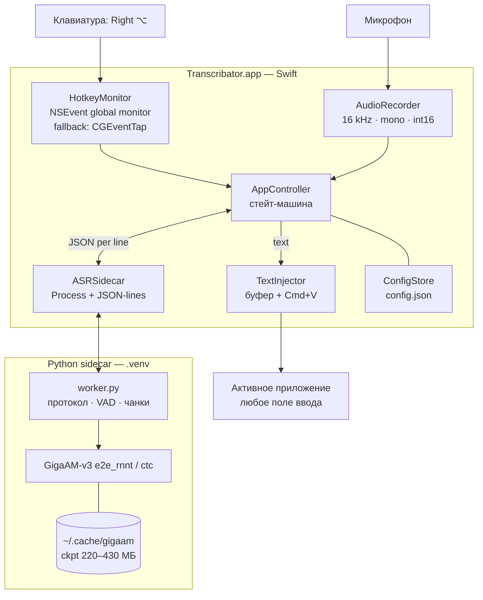
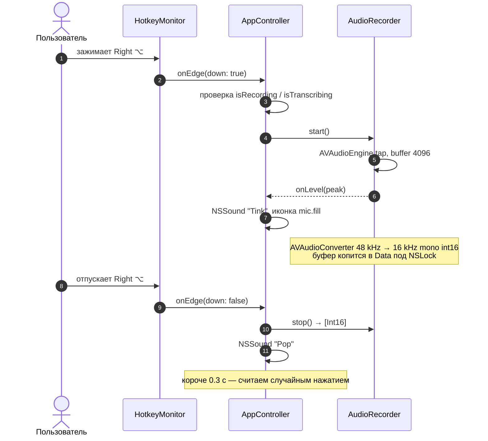
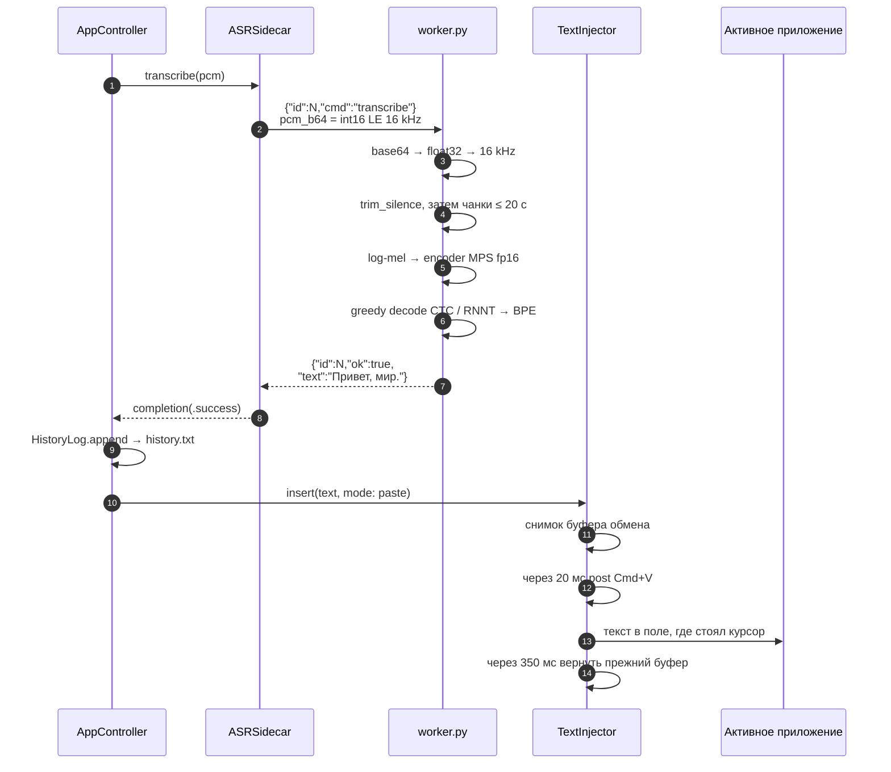
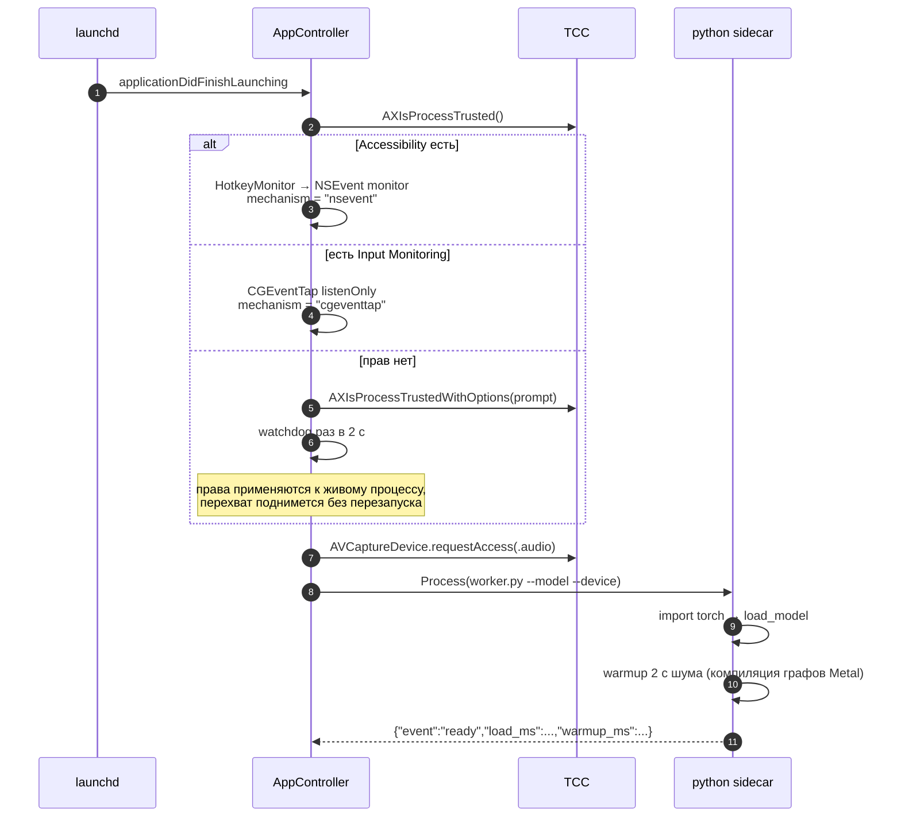
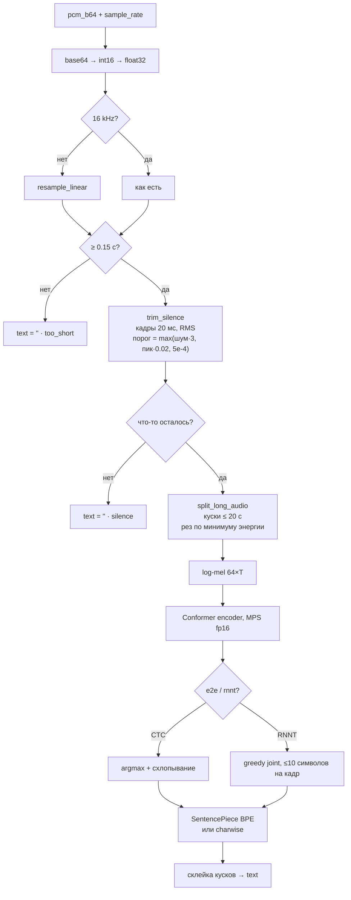
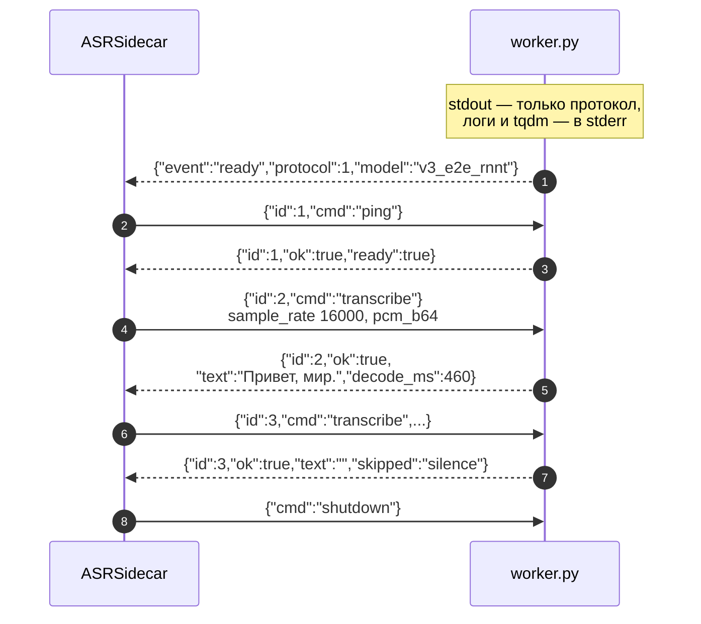
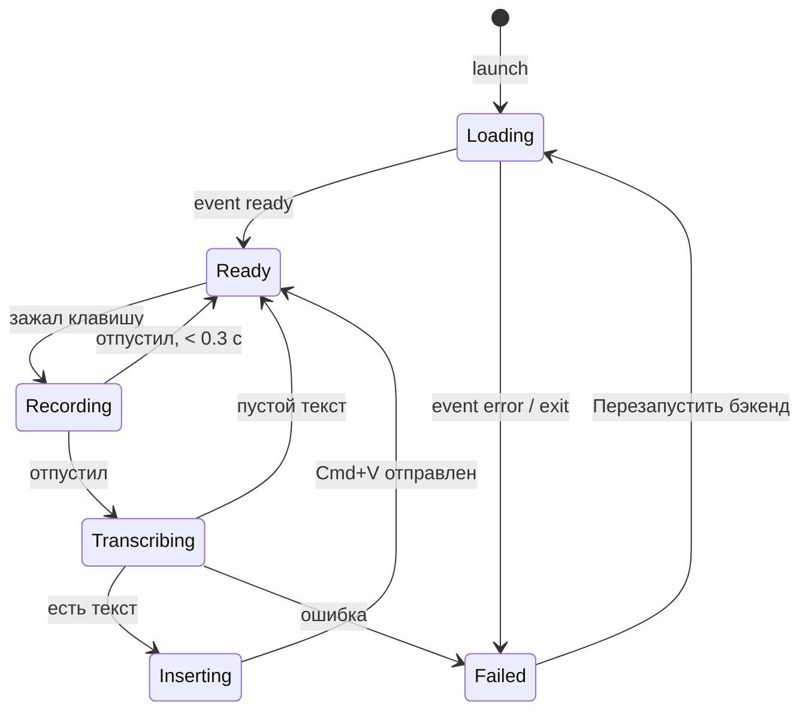
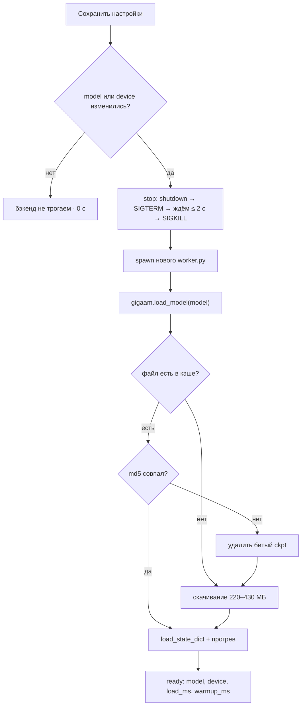

# Как это работает

Диаграммы ниже — актуальное описание того, что происходит в коде. Mermaid рендерится
прямо на GitHub.

- Приложение: `macapp/` (Swift, menu bar, `LSUIElement`)
- Распознавание: `backend/worker.py` (Python-сайдкар, GigaAM-v3, MPS/CPU)
- Контракт между ними: построчный JSON через pipe

---

## 1. Компоненты

Два процесса, потому что GigaAM — это PyTorch + SentencePiece + CTC/RNNT-декодинг.
Держать тёплый Python-сайдкар дешевле, чем переписывать декодер на Swift.

---

## 2. Запись: зажал → сказал → отпустил

---

## 3. Распознавание и вставка

Задержка после отпускания клавиши: отправка PCM по pipe (~1 мс), VAD + mel (~10 мс),
энкодер и декодер (~300–500 мс на 11 с аудио). Итого ≈ 0.5 с — модель уже прогрета.

---

## 4. Старт приложения и права

Права:

| Разрешение | Зачем | Когда запрашивается |
| --- | --- | --- |
| Микрофон | запись | при старте |
| Универсальный доступ (Accessibility) | перехват клавиши + Cmd+V | при старте, если перехват не поднялся |
| Мониторинг ввода (Input Monitoring) | запасной CGEventTap | по кнопке «Запросить доступы…» |

---

## 5. Что происходит с аудио внутри воркера

VAD не роскошь: в push-to-talk вокруг фразы всегда много тишины. Обрезка экономит
20–40 % инференса и не даёт модели «галлюцинировать» на шуме.

---

## 6. Протокол приложение ↔ воркер

Ответы сопоставляются по `id`. Если процесс умер — `terminationHandler` переводит
состояние в `.failed`, это видно в меню.

---

## 7. Состояния иконки в меню-баре

| Состояние | Иконка | Подпись в меню |
| --- | --- | --- |
| Loading | ⌛ hourglass | «Загружаю v3_ctc… 12 с» / «Скачиваю… 220–430 МБ» |
| Ready | 🎙 mic | «Готов: v3_ctc (mps)» |
| Recording | 🎙 mic.fill, красная | — |
| Transcribing | 〜 waveform, оранжевая | — |
| Failed | ⚠︎ треугольник | текст ошибки из воркера |

---

## 8. Смена модели и самолечение кэша

Типичная «долгая загрузка» — это скачивание, а не сама модель: до 430 МБ на каждый
новый вариант. Из кэша переключение занимает ~4 с. Недокачанный `ckpt` (прерванное
переключение) ломает md5 — воркер это замечает, удаляет файл и качает заново.

---

## 9. Тайминги на M1 Pro / 16 ГБ

| Операция | Время |
| --- | --- |
| Старт приложения → `ready` | ~6 с |
| Распознавание 11.3 с аудио (MPS) | 0.48 с |
| То же на CPU | 0.6–0.7 с |
| VAD: 8 с записи с паузами | ~8 мс, остаётся 5.8 с |
| Смена модели из кэша | ~4 с |
| Память сайдкара (RSS) | ~1.8 ГБ |
